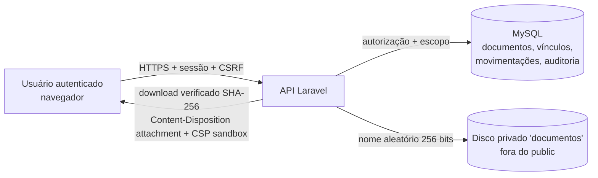

# SECURITY-NOTES — SIGARB

Registro do portão de segurança (§6.4 do MEGABRAIN / skill `mb-sec-gate`). O modelo de ameaças completo do sistema está em
`docs/seguranca/MODELO-AMeACAS.md`; documentos e upload em `docs/seguranca/DOCUMENTOS.md`; permissões em `docs/seguranca/MATRIZ-PERMISSOES.md`.
Sem segredos nem dados pessoais neste arquivo.

## 2026-11-19 — Saída pela tela de saldos, origem com "Outro…", anexos e Documentos (branch `feat/saida-origem-documentos`)

### Nível de risco
**R4** — dados de efetivo (CPF, matrícula), inventário de armamento e munição, vários serviços (API, banco, web) e uso institucional
por várias bases. O baseline também sugere R4. Não implantado; MVP com dados sintéticos.

### Escopo da mudança
| Superfície | Novo/alterado | Autorização no servidor |
|---|---|---|
| `GET /stock/origins` | novo | `estoque.entrada` (ENTRADA) ou `estoque.saida` (SAIDA); só movimentações de locais do escopo, sem depósito oculto |
| `POST /movements` SAIDA/BAIXA | já existia (UI nova) | `estoque.saida`/`estoque.baixar` no local; `exigirLocalVisivel`; idempotência; saldo nunca negativo (`SALDO_INSUFICIENTE`) |
| `POST /movements/{id}/documents` | novo (upload) | registro visível (`estoque.ver` + depósito visível) senão 404; `documentos.enviar` na unidade senão 403; registro alheio exige `documentos.gerir` (403 `ANEXO_SO_RESPONSAVEL`); unidade definida pelo servidor |
| `POST /documents/{codigo}/versions` | novo (upload) | documento no escopo de `documentos.enviar` senão 404; só quem enviou (403 `VERSAO_SO_DE_QUEM_ENVIOU`) |
| `GET /documents/pending-records` | novo | `documentos.enviar`; locais com `estoque.ver` ∩ unidades com `documentos.enviar` |
| `GET /documents` | busca ampliada | `documentos.ver` (escopo na query); busca/filtro pelo registro ligado só considera registros visíveis com `estoque.ver` |

### Fluxo de dados

Fronteiras: internet ↔ API (sessão, CSRF, throttle); API ↔ disco privado (nunca servido pelo servidor web); usuário ↔ escopo de unidade (filtro na query).

### Ameaças avaliadas (STRIDE + abuso)
| # | Ameaça | P×I | Tratamento | Evidência |
|---|---|---|---|---|
| T1 | Upload de executável/HTML/SVG/PDF com script disfarçado | 3×5 | Lista branca PDF/PNG/JPG por **assinatura + finfo** (não só extensão), PDF ativo/comprimido recusado, ≤ 10 MB, nome aleatório, disco privado | `DocumentoService::inspecionar`; testes `test_upload_invalido_e_recusado_por_tipo_e_tamanho`, `DocumentoTest` |
| T2 | IDOR: anexar/baixar documento de outra unidade | 3×4 | Escopo na query; 404 fora do escopo (não revela); tentativas auditadas | `test_anexo_respeita_escopo_e_quem_registrou`, `test_download_de_anexo_negado_fora_do_escopo` |
| T3 | Usuário anexa arquivo falso ao registro de outra pessoa | 2×3 | Só quem registrou ou `documentos.gerir` | `ANEXO_SO_RESPONSAVEL` testado |
| T4 | Substituir arquivo de terceiro / apagar evidência | 2×4 | Arquivo imutável (trigger); nova versão é outro registro, só de quem enviou; anterior mantida | `test_nova_versao_so_de_quem_enviou…` |
| T5 | Path traversal pelo nome do arquivo | 2×4 | Caminho derivado só do id aleatório; nome original saneado e só para exibição | `Documento::caminho`, `sanearNome` |
| T6 | Vazamento por busca (conteúdo de registro fora do escopo) | 2×2 | Busca/filtro pelo registro restritos a locais visíveis (corrigido nesta revisão) | `DocumentoController::index` (`$visivel`) |
| T7 | Saída dupla por reenvio / saldo negativo | 3×4 | Idempotency-Key + hash; `debitarLote` com lock e checagem | `test_saida_e_idempotente`, `test_saida_reduz_saldo…` |
| T8 | Lista de origens expõe texto livre de outras bases | 2×2 | Só locais do escopo da permissão de registrar | `test_origens_listam_as_usadas_no_escopo…` |
| T9 | Repúdio (quem anexou/baixou) | 2×3 | Auditoria append-only: `documento.enviado` (com `origem_envio`, `movimentacao_id`, SHA-256), `documento.nova_versao`, `documento.anexo_negado`, `documento.download`, `documento.acesso_negado` | testes acima |
| T10 | Abuso de volume de upload | 2×2 | `throttle:20,1` nas rotas de upload; limite de tamanho | `routes/api.php` |

LINDDUN: documentos podem conter dados pessoais (termos assinados, notas); acesso restrito por unidade, download auditado, sem URL pública,
`Cache-Control: no-store`. Retenção e classificação de sigilo continuam pendentes institucionais (P-08/P-09), sem mudança aqui.

### Baseline (`sec_baseline.py`, somente código, 2026-11-19)
**0 BLOCKER · 9 AVISO · 6 INFO.** Os avisos são anteriores a esta mudança: `APP_DEBUG` ligado no `.env` local e no `.env.example`;
Dockerfile `infra/prodlocal/apache` sem USER não-root; `backend/package.json` sem lockfile; `.npmrc` e modelos `.sql` versionados (conferir
que não têm segredo). Auditoria de dependências (osv/npm audit) não executada nesta sessão.

### Skills irmãs
`mb-appsec`, `mb-api-security`, `mb-data-protection` aplicadas como revisão dirigida ao diff (rotas novas, autorização, upload, dados pessoais),
com o achado T6 corrigido. Não houve teste ativo contra URL (nada implantado).

### Decisão do gate
**LIBERADO COM RESSALVAS para merge local** (nenhum BLOCKER novo). Para produção, antes do deploy: rodar a suíte, aplicar a migração com
backup, conferir `APP_DEBUG=false` e a permissão do disco `documentos` na VM, e rodar auditoria de dependências.

### Próxima revisão
No deploy desta branch ou em nova mudança de upload/autorização (R4: no máximo 90 dias).
