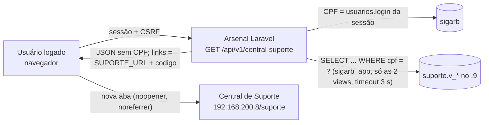
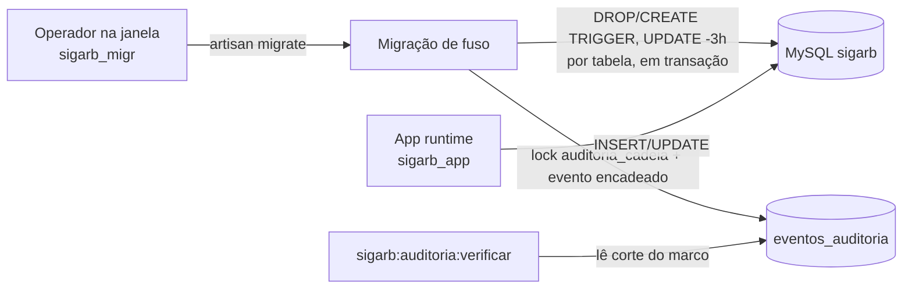
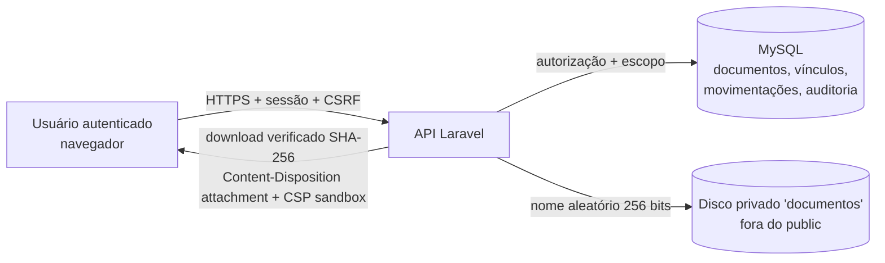

# SECURITY-NOTES — SIGARB

Registro do portão de segurança (§6.4 do MEGABRAIN / skill `mb-sec-gate`). O modelo de ameaças completo do sistema está em
`docs/seguranca/MODELO-AMeACAS.md`; documentos e upload em `docs/seguranca/DOCUMENTOS.md`; permissões em `docs/seguranca/MATRIZ-PERMISSOES.md`.
Sem segredos nem dados pessoais neste arquivo.

## 2026-11-19 — Remoção do Docker: dev, testes e release nativos (branch `chore/sem-docker`, ADR-016)
**Nível:** R4 do sistema (inalterado). **Escopo da mudança:** ferramentas de desenvolvimento/teste e o build da release;
nenhum código de aplicação, rota, autorização ou migração alterado; `deploy/ops/*` intacto.

### Ameaças consideradas (cadeia de build e estação)
| Ameaça | Tratamento |
|---|---|
| Build da release dependente de ferramentas do host (antes: imagens fixadas por digest) | Versões exatas vêm do `composer.lock`/`package-lock.json`; `composer install --no-dev` + `validate --strict`, `npm ci`; `COMPOSER_HOME` e cache npm descartáveis (sem config/credenciais globais), `--no-scripts`; MANIFESTO registra PHP/Composer/Node/npm do build; tar determinístico e SHA256SUMS mantidos. Risco residual: um Composer/Node comprometido na máquina de build — mitigar construindo só em máquina confiável e conferindo o SHA-256 de dois builds. |
| Bancos de outros sistemas no mesmo MySQL local | `database/dev/preparar.sh` só cria/atualiza `sigarb*` e usuários `sigarb*`@`localhost`; `ecossistema` criado só se não existir (sem os GRANT da produção). |
| Privilégios do runtime (ADR-013) deixarem de ser testados | `sigarb_app`/`sigarb_migr`@`localhost` com os mesmos grants de `deploy/modelos/privilegios-vm.sql`; `scripts/verificar-privilegios.sh` agora também confere que o login do `sigarb_app` funciona antes de contar as negações. |
| Teste de implantação como root na estação | `scripts/testar-implantacao.sh` exige root e **recusa** rodar se o usuário `sigarb` ou `/srv/sigarb` já existirem (só VM descartável); limpa usuário, diretórios e schema no fim. |
| Segredos de dev espalhados | `infra/.env` deixa de existir; segredos locais só no `backend/.env` (ignorado, 0600); nenhum segredo nos scripts/SQL versionados (só marcadores `@SENHA_*@`). |

### Baseline (`sec_baseline.py`, código, 2026-11-19)
**0 BLOCKER · 7 AVISO · 5 INFO** (antes 9 AVISO: saiu o aviso do Dockerfile `infra/prodlocal/apache` sem USER). Avisos restantes são
anteriores: `APP_DEBUG` no `.env` local/`.env.example`, `backend/package.json` sem lockfile, `.npmrc` e modelos `.sql` versionados (sem segredo).

### Decisão
**LIBERADO COM RESSALVAS para merge local.** Ressalvas: `testar-implantacao.sh` nativo não foi executado (exige root em VM descartável);
`composer audit` depende de rede para o packagist.

## 2026-11-19 — Integração com a Central de Suporte PRB (branch `feat/central-suporte`)

```
SEC-GATE — Arsenal (integração Central de Suporte PRB) · tier R3 (CPF como chave entre bancos de sistemas diferentes;
  usuários internos, rede interna) dentro do sistema R4 · 2026-11-19
Baseline: 0 BLOCKER · 4 AVISO · 3 INFO (sec_baseline.py --path backend; todos pré-existentes, nenhum no código novo)
Threats: 6 (top 3: vazamento entre pessoas por CPF vindo do cliente; link hostil vindo da view; Central fora do ar travando o Arsenal)
Plan: mb-appsec (código novo) → mb-api-security (rota nova: sessão, escopo) → mb-data-protection (CPF em cache/log/resposta)
Gate: LIBERADO COM RESSALVAS (pendências de implantação P1–P3; nenhuma BLOCKER aberta no código)
Next review: ao ligar SUPORTE_DB_DATABASE em produção / mudança do contrato das views
```

### Escopo
- `GET /api/v1/central-suporte` (novo; sessão + `UsuarioAtivo` + `PendenciaAcesso`; throttle 60/min): lê **só SELECT** as views
  `suporte.v_chamados_solicitante` e `suporte.v_notificacoes_solicitante` (conexão `suporte`, mesma credencial `DB_*`/`sigarb_app`).
- Front: avisos da Central somados ao sino (abrem na Central em nova aba), cartão "Meus chamados na Central PRB" em Alertas e na
  Central de suporte do Arsenal, "Abrir chamado na Central PRB" no sino, em Alertas, em Suporte e na página não encontrada.
- O módulo de suporte próprio do Arsenal (`/support/*`, `/notifications`, telas Suporte/Atendimento) **não foi alterado**.
- Env novas: `SUPORTE_DB_DATABASE` (vazia = leitura desligada), `SUPORTE_URL` (padrão `http://192.168.200.8/suporte`).

### Fluxo de dados

Fronteiras: navegador ↔ API (sessão); API ↔ banco `suporte` (outro sistema; credencial só com SELECT nas views); navegador ↔ Central (outra aplicação, outra sessão).

### Registro de ameaças
| # | Ameaça (STRIDE/LINDDUN) | P×I | Tratamento | Evidência |
|---|---|---|---|---|
| T1 | Ver chamados/avisos de outra pessoa trocando o CPF (I, IDOR) | 4×4 | CPF **só** de `$r->user()->login`; query string ignorada; login que não é CPF válido = nada lido | `CentralSuporteTest::test_so_chamados_e_avisos_do_cpf_da_sessao_e_sem_cpf_na_resposta` (`?cpf=`/`?login=` de outra pessoa ignorados), `test_cada_usuario_ve_so_o_seu_mesmo_com_cache`; vitest: cliente nunca envia CPF |
| T2 | Link hostil na view (`javascript:`) virar XSS/phishing (T) | 2×4 | `link` da view **não** é repassado; link = `SUPORTE_URL` + `/chamados/` + `codigo` (26 alfanum.); `SUPORTE_URL` só http(s); front revalida http(s) | `test_so_chamados...`, `test_link_abrir_chamado...`, `CentralSuporte.test.tsx` |
| T3 | Central/banco fora do ar travar ou derrubar o Arsenal (D) | 3×4 | env vazia = sem conexão; timeout 3 s; `try/catch` → `disponivel:false` 200; falha também em cache 60 s; front esconde blocos | `test_sem_env...`, `test_banco_ausente...`, `test_views_ausentes...`; vitest "Central fora do ar" |
| T4 | CPF exposto em resposta, log ou chave de cache (I / LINDDUN identificabilidade) | 3×3 | resposta sem CPF; log só a classe da exceção; chave = sha256(CPF + APP_KEY) | `test_so_chamados...` (CPF ausente do corpo) |
| T5 | Abuso da credencial `sigarb_app` para ler/alterar dados da Central (E/T) | 2×4 | grant da Central só `SELECT` nas 2 views; o Arsenal não escreve nada no `suporte` | conferir grants no deploy (P1) |
| T6 | Aviso lido na Central continuar no sino até 60 s (cache) | 1×1 | aceito (contrato: cache de 60 s) | — |

Auditoria: não registrada — é leitura dos próprios dados (mesmo padrão de `GET /notifications`); `test_leitura_nao_grava_auditoria`.

### Pendências de implantação (ressalvas do gate)
- P1: antes de ligar `SUPORTE_DB_DATABASE=suporte`, conferir no .9 `SHOW GRANTS FOR 'sigarb_app'@'192.168.200.8'` = só `SELECT` nas duas views.
- P2: `SUPORTE_URL` só `http://192.168.200.8/suporte` (rede interna, sem TLS); quando a Central ganhar HTTPS, trocar.
- P3: `php artisan config:cache` depois de editar o `.env`.

## 2026-11-19 — Fuso America/Maceio e conversão do histórico UTC (branch `feat/fuso-maceio`, ADR-015)

### Nível e escopo
**R4** (mesmo sistema). Escopo do gate restrito à **integridade da auditoria e da imutabilidade**: migração
`2026_12_01_000100_fuso_america_maceio`, `ConversaoFusoService` (remove e recria gatilhos `BEFORE UPDATE`, converte −3 h) e
`AuditoriaService::verificar()` (corte ancorado no evento `sistema.fuso.convertido`). Nenhuma rota nova; nada implantado.

### Fluxo

Fronteira relevante: `sigarb_app` (runtime, sem DDL) ↔ `sigarb_migr` (DDL, só na janela).

### Ameaças avaliadas
| # | Ameaça | P×I | Tratamento | Evidência |
|---|---|---|---|---|
| F1 | Conversão quebra a cadeia de hash | 3×5 | Hashes não recalculados; verificador reconstrói `ocorrido_em` original até o corte | `test_servidor_em_menos_tres_…` (verificar = null antes e depois) |
| F2 | Gatilhos de imutabilidade ficam desligados (falha/queda no meio) | 2×5 | Definições guardadas antes de remover; recriação em `finally`; `garantirGatilhos()` confere ao fim | `test_retomada_apos_queda_…`, `test_gatilhos_de_imutabilidade_continuam_ativos_depois` (lista idêntica) |
| F3 | Credencial de runtime (`sigarb_app`, UPDATE em tudo) troca a definição guardada para que o `sigarb_migr` recrie um gatilho no-op | 2×5 | HMAC (APP_KEY) de tabela+definição; nomes e momento validados; adulterado = falha fechada | `test_retomada_recusa_definicao_de_gatilho_adulterada` |
| F4 | Alterar o corte para mascarar adulteração | 2×4 | Corte está no evento encadeado (hash); deslocamento aceito só −10800; corte ≥ id do marco = falha | `test_corte_adulterado_e_detectado` |
| F5 | Conversão dupla (−6 h) | 3×3 | Marca por tabela na mesma transação do UPDATE; marca global; `down()` recusa | `test_rodar_duas_vezes_…`, `test_banco_novo_so_recebe_a_marca` |
| F6 | Release antiga grava UTC durante a migração | 3×2 | Janela sem operação (RUNBOOK §8) | risco aceito, documentado |

**Risco residual (mesma classe do ADR-007):** um ator com DDL e sem chave podia já reescrever a cadeia inteira; com o marco, ele também
poderia anexar um marco falso para deslocar exatamente −3 h eventos antigos de um banco ainda não convertido. Mitigação proposta continua
a da `docs/seguranca/AUDITORIA.md` (âncora externa/HMAC da cadeia), dependente de P-01/P-08.

### Baseline e decisão
`sec_baseline.py` (2026-11-19 15:28): **0 BLOCKER**, 9 AVISO (todos anteriores: `APP_DEBUG` no `.env` local, Dockerfile prodlocal sem USER,
`backend/package.json` sem lock, modelos `.sql` versionados sem segredo), 5 INFO. **Gate: LIBERADO COM RESSALVAS** — implantação só com
backup verificado imediatamente antes e janela sem operação (RUNBOOK §8). Próxima revisão: antes do deploy desta branch.

## 2026-11-19 — Saída pela tela de saldos, origem com "Outro…", anexos e Documentos (branch `feat/saida-origem-documentos`)

### Nível de risco
**R4** — dados de efetivo (CPF, matrícula), inventário de armamento e munição, vários serviços (API, banco, web) e uso institucional
por várias bases. O baseline também sugere R4. Não implantado; MVP com dados sintéticos.

### Escopo da mudança
| Superfície | Novo/alterado | Autorização no servidor |
|---|---|---|
| `GET /stock/origins` | novo | `estoque.entrada` (ENTRADA) ou `estoque.saida` (SAIDA); só movimentações de locais do escopo, sem depósito oculto |
| `POST /movements` SAIDA/BAIXA | já existia (UI nova) | `estoque.saida`/`estoque.baixar` no local; `exigirLocalVisivel`; idempotência; saldo nunca negativo (`SALDO_INSUFICIENTE`) |
| `POST /movements/{id}/documents` | novo (upload) | registro visível (`estoque.ver` + depósito visível) senão 404; `documentos.enviar` na unidade senão 403; registro alheio exige `documentos.gerir` (403 `ANEXO_SO_RESPONSAVEL`); unidade definida pelo servidor |
| `POST /documents/{codigo}/versions` | novo (upload) | documento no escopo de `documentos.enviar` senão 404; só quem enviou (403 `VERSAO_SO_DE_QUEM_ENVIOU`) |
| `GET /documents/pending-records` | novo | `documentos.enviar`; locais com `estoque.ver` ∩ unidades com `documentos.enviar` |
| `GET /documents` | busca ampliada | `documentos.ver` (escopo na query); busca/filtro pelo registro ligado só considera registros visíveis com `estoque.ver` |

### Fluxo de dados

Fronteiras: internet ↔ API (sessão, CSRF, throttle); API ↔ disco privado (nunca servido pelo servidor web); usuário ↔ escopo de unidade (filtro na query).

### Ameaças avaliadas (STRIDE + abuso)
| # | Ameaça | P×I | Tratamento | Evidência |
|---|---|---|---|---|
| T1 | Upload de executável/HTML/SVG/PDF com script disfarçado | 3×5 | Lista branca PDF/PNG/JPG por **assinatura + finfo** (não só extensão), PDF ativo/comprimido recusado, ≤ 10 MB, nome aleatório, disco privado | `DocumentoService::inspecionar`; testes `test_upload_invalido_e_recusado_por_tipo_e_tamanho`, `DocumentoTest` |
| T2 | IDOR: anexar/baixar documento de outra unidade | 3×4 | Escopo na query; 404 fora do escopo (não revela); tentativas auditadas | `test_anexo_respeita_escopo_e_quem_registrou`, `test_download_de_anexo_negado_fora_do_escopo` |
| T3 | Usuário anexa arquivo falso ao registro de outra pessoa | 2×3 | Só quem registrou ou `documentos.gerir` | `ANEXO_SO_RESPONSAVEL` testado |
| T4 | Substituir arquivo de terceiro / apagar evidência | 2×4 | Arquivo imutável (trigger); nova versão é outro registro, só de quem enviou; anterior mantida | `test_nova_versao_so_de_quem_enviou…` |
| T5 | Path traversal pelo nome do arquivo | 2×4 | Caminho derivado só do id aleatório; nome original saneado e só para exibição | `Documento::caminho`, `sanearNome` |
| T6 | Vazamento por busca (conteúdo de registro fora do escopo) | 2×2 | Busca/filtro pelo registro restritos a locais visíveis (corrigido nesta revisão) | `DocumentoController::index` (`$visivel`) |
| T7 | Saída dupla por reenvio / saldo negativo | 3×4 | Idempotency-Key + hash; `debitarLote` com lock e checagem | `test_saida_e_idempotente`, `test_saida_reduz_saldo…` |
| T8 | Lista de origens expõe texto livre de outras bases | 2×2 | Só locais do escopo da permissão de registrar | `test_origens_listam_as_usadas_no_escopo…` |
| T9 | Repúdio (quem anexou/baixou) | 2×3 | Auditoria append-only: `documento.enviado` (com `origem_envio`, `movimentacao_id`, SHA-256), `documento.nova_versao`, `documento.anexo_negado`, `documento.download`, `documento.acesso_negado` | testes acima |
| T10 | Abuso de volume de upload | 2×2 | `throttle:20,1` nas rotas de upload; limite de tamanho | `routes/api.php` |

LINDDUN: documentos podem conter dados pessoais (termos assinados, notas); acesso restrito por unidade, download auditado, sem URL pública,
`Cache-Control: no-store`. Retenção e classificação de sigilo continuam pendentes institucionais (P-08/P-09), sem mudança aqui.

### Baseline (`sec_baseline.py`, somente código, 2026-11-19)
**0 BLOCKER · 9 AVISO · 6 INFO.** Os avisos são anteriores a esta mudança: `APP_DEBUG` ligado no `.env` local e no `.env.example`;
Dockerfile `infra/prodlocal/apache` sem USER não-root; `backend/package.json` sem lockfile; `.npmrc` e modelos `.sql` versionados (conferir
que não têm segredo). Auditoria de dependências (osv/npm audit) não executada nesta sessão.

### Skills irmãs
`mb-appsec`, `mb-api-security`, `mb-data-protection` aplicadas como revisão dirigida ao diff (rotas novas, autorização, upload, dados pessoais),
com o achado T6 corrigido. Não houve teste ativo contra URL (nada implantado).

### Decisão do gate
**LIBERADO COM RESSALVAS para merge local** (nenhum BLOCKER novo). Para produção, antes do deploy: rodar a suíte, aplicar a migração com
backup, conferir `APP_DEBUG=false` e a permissão do disco `documentos` na VM, e rodar auditoria de dependências.

### Próxima revisão
No deploy desta branch ou em nova mudança de upload/autorização (R4: no máximo 90 dias).
