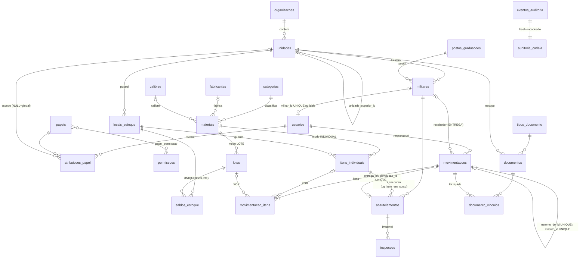
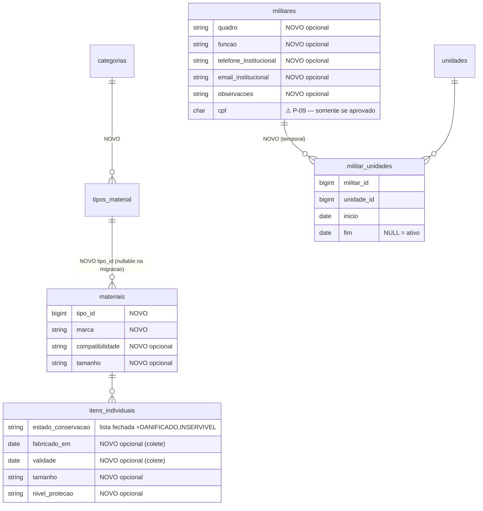

# 02 — Comparativo formal do DER

## 1. DER proposto (Doc §3, figura) — leitura da imagem
Entidades: UNIDADES (auto-relação), COLABORADORES (cpf UK, unidade_principal_id), COLABORADOR_UNIDADES (data_inicio/fim), LOCAIS_ESTOQUE, CATEGORIAS_MATERIAIS → TIPOS_MATERIAIS (forma_controle) → MATERIAIS (tipo_id, fabricante_id, marca, modelo, descricao, unidade_medida), FABRICANTES, ITENS_INDIVIDUAIS (identificador_interno UK, numero_serie **sem UK**, estado_conservacao e situacao_operacional como **string livre**), LOTES_ESTOQUE (quantidade_recebida, **saldo_atual**, validade, local_estoque_id), ENTREGAS → ENTREGA_ITENS (item_individual_id **ou** lote_estoque_id, quantidade), DEVOLUCOES → DEVOLUCAO_ITENS (entrega_item_id, quantidade_devolvida).

Cardinalidades desenhadas: todas 1:N opcionais; ITENS_INDIVIDUAIS → ENTREGA_ITENS é 1:0..N (correto para histórico). Observações:
- **Não há** PK/UK que impeça o mesmo item em duas entregas abertas — RF-VIN-05 fica só na aplicação.
- `entrega_itens` não tem CHECK "item XOR lote"; está só no texto (Doc §4).
- `lotes_estoque` amarra **um lote a um local** — mover parte de um lote exige criar outro lote (perde identidade do lote do fabricante).
- Sem usuários/perfis no diagrama (listados à parte em Doc §5); `responsavel_id` aponta para quê não é dito.
- Sem idempotência, sem estorno, sem imutabilidade, sem escopo de autorização.
- Documentos: "entidade relacionada" genérica (polimórfica) — sem integridade referencial.

## 2. AS-IS — esquema real (migrações em `main@50ff2d8`)

Também existem: inventários (`inventarios`, `inventario_itens`, contadores append-only), suporte (chamados), dispositivos confiáveis, sessões.

Constraints que importam (todas em MySQL, cobertas por testes):
- `chk_saldo_reserva` (reservado ≤ quantidade) e `unsignedBigInteger` (saldo ≥ 0).
- `chk_item_xor_lote`, `chk_qtd_positiva` (item individual ⇒ quantidade = 1).
- Triggers de imutabilidade em `movimentacoes`, `movimentacao_itens`, `inspecoes`, `documentos` (arquivo), `documento_vinculos`, auditoria.
- `chave_idempotencia` UNIQUE + `hash_requisicao` (repetição com corpo diferente é rejeitada).
- `estorno_de_id` UNIQUE (um estorno por movimentação), `vinculo_id` UNIQUE (uma conclusão por abertura).
- `uq_item_em_curso` (coluna gerada): um acautelamento em curso por item.
- `restrictOnDelete` em praticamente todas as FKs.

## 3. Mapeamento entidade a entidade

| Proposto | Existente | Veredito |
|---|---|---|
| colaboradores | `militares` | **Mesmo conceito.** Estender, não duplicar. |
| colaborador_unidades | — | Lacuna (adotar depois, temporal). |
| unidades | `unidades` (+`organizacoes`, `caminho`) | Existente é superior (multi-organização, escopo por subárvore). |
| postos_graduacoes | `postos_graduacoes` | Igual. |
| categorias_materiais | `categorias` (+`natureza`) | Igual. |
| tipos_materiais | — | **Lacuna real.** |
| fabricantes | `fabricantes` | Igual. |
| marcas / modelos (Doc §7) | `materiais.modelo` | Coluna basta no MVP. |
| materiais | `materiais` | Igual; falta `tipo_id`, `marca`. `forma_controle` do doc fica no tipo; aqui no material (mais preciso, P-04). |
| materiais_armas_fogo / _baixa_letalidade / _coletes / _municoes | — | Não criar 4 tabelas; ver §5. |
| itens_individuais | `itens_individuais` | Existente é mais forte (série única por material, situação controlada pelo razão). Falta validade/fabricação por unidade (colete). |
| lotes_estoque (com saldo_atual, local) | `lotes` + `saldos_estoque` | Existente é **melhor**: lote independe do local; saldo por (local,lote) com reserva e CHECK; recebido = soma das ENTRADAS no razão. |
| locais_estoque | `locais_estoque` | Igual (+tipo, código). |
| entregas / entrega_itens | `movimentacoes(tipo=ENTREGA, militar_id)` / `movimentacao_itens` | Equivalente e imutável. Não duplicar. |
| devolucoes / devolucao_itens | `movimentacoes(DEVOLUCAO, vinculo_id)` / itens | Equivalente; **falta parcial** e conservação na devolução de entrega (o acautelamento já registra). |
| documentos (entidade relacionada genérica) | `documentos` + `documento_vinculos` (FK tipada) | Existente é melhor (integridade referencial, arquivo imutável, escopo). |
| usuarios / perfis / permissoes / usuario_unidades | `usuarios` / `papeis` / `permissoes` / `atribuicoes_papel(unidade_id)` | Igual em conceito; existente já liga papel ao escopo. |
| auditorias | `eventos_auditoria` + `auditoria_cadeia` | Existente é superior (append-only + hash). |
| historico_situacoes | derivável do razão + auditoria | Não criar (duplicaria). |
| movimentacoes | `movimentacoes` | Já existe, com mais tipos. |
| estados_conservacao / situacoes_operacionais (tabelas) | enum / validação | Ver Q7 em `03`. |
| — (ausente no doc) | acautelamentos, inspeções, inventários, reserva, transferência 2 tempos, estorno | **Omitidos pelo doc** — específicos de reserva bélica. |

## 4. Questão do "aéreo"
- Busca em `ronda-do-bairro/` e `docs/` por "aéreo/aereo/aviação/aeronave": **nenhum artefato**. Semelhança direta **não verificável**.
- Conceitos genéricos (qualquer almoxarifado): unidades, categorias/tipos, fabricantes, item/lote, local, entrega/devolução, documentos.
- Específicos do SIGARB e **ausentes no DER**: acautelamento com aprovação segregada (P-06), inspeção periódica, carteira, inventário com contagem cega e aprovação, reserva, transferência em trânsito, baixa, estorno, idempotência, escopo por unidade.
- Indícios de modelo importado: `saldo_atual` mutável no lote; lote preso a um local; devolução como documento próprio (padrão de empréstimo de ferramentas/equipamentos); ausência de ciclo de vida de arma.
- Conclusão: o DER **restringe** o modelo atual (lote×local) e omite o ciclo de vida armamentista. Avaliado pelo mérito, ele é um bom **checklist de cadastro**, não um modelo de dados a adotar.

## 5. Tabelas especializadas por categoria (Q5/Q6)
4 tabelas 1:1 com `materiais` trariam: joins em toda listagem, migração de dados, validação condicional duplicada (banco + request), e um novo tipo de material exigiria nova tabela. O próprio Doc §5 diz "não será necessário criar uma tabela exclusiva para cada tipo".
Recomendação: **um nível `tipos_material` com um conjunto fechado de colunas opcionais** em `materiais`/`itens_individuais` (ex.: `marca`, `tamanho`, `nivel_protecao`, `compatibilidade`, `tipo_arma`, `fabricado_em`, `validade`) e uma regra por tipo dizendo **quais são obrigatórios** (validação no FormRequest + formulário condicional). Mantém RF-MAT-02 (campos fixos) sem EAV e sem joins.

## 6. TO-BE (somente mudanças justificadas; ⚠ = depende de decisão)

⚠ Devolução parcial (P-05): se aprovada, **novo tipo de conclusão** no razão que referencie a entrega com quantidade ≤ pendente (calculado a partir do razão), sem tabela `devolucoes`.

## 7. Tabela de diferenças AS-IS → TO-BE

| Mudança | Tipo | Migração | Status |
|---|---|---|---|
| `tipos_material` + `materiais.tipo_id` | adicionar entidade/FK | aditiva, backfill 1 tipo por categoria | Adotar depois |
| `materiais.marca`, `compatibilidade`, `tamanho` | colunas | aditiva nullable | Adotar depois (pequena) |
| `itens_individuais.fabricado_em`, `validade`, `tamanho`, `nivel_protecao` | colunas | aditiva nullable | Adotar depois |
| `estado_conservacao` lista fechada | validação (+enum opcional) | nenhuma se só validação | **Adotar agora** |
| `militares.quadro`, `funcao`, contatos, `observacoes` | colunas | aditiva nullable | Adotar depois (pequena) |
| `militar_unidades` temporal | entidade | aditiva | Adotar depois |
| `militares.cpf` | coluna sensível | aditiva + criptografia/índice cego | ⚠ P-09 |
| Devolução parcial | tipo de movimentação | enum + regra | ⚠ P-05 |
| `colaboradores`, `entregas`, `devolucoes`, `lotes_estoque.saldo_atual`, tabelas por categoria, `auditorias`, `historico_situacoes`, `marcas`, `modelos` | — | — | **Não adotar** |

## 8. Regras de integridade
Permanecem inalteradas: todas as do §2. Novas, se o TO-BE for aprovado:
- `militar_unidades`: FK restrict; CHECK `fim IS NULL OR fim >= inicio`; unicidade de vínculo **ativo** por (militar, unidade) via coluna gerada (mesmo padrão de `uq_item_em_curso`); regra no serviço: unidade ≠ `militares.unidade_id`.
- `tipos_material.categoria_id` FK restrict; `(categoria_id, nome)` unique.
- `itens_individuais`: CHECK `validade IS NULL OR fabricado_em IS NULL OR validade >= fabricado_em`.
- CPF (se aprovado): armazenado só dígitos, validado por dígito verificador, **cifrado** (cast `encrypted`) + coluna de hash HMAC unique para unicidade/busca; nunca em logs/auditoria em claro.
